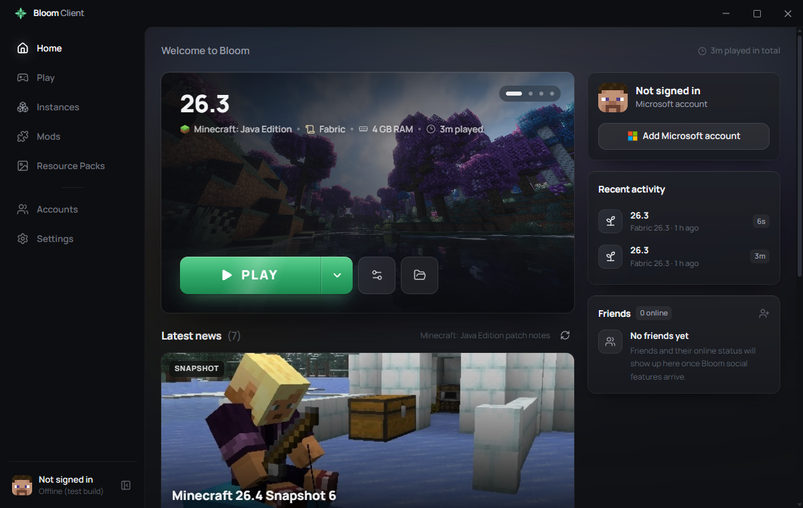
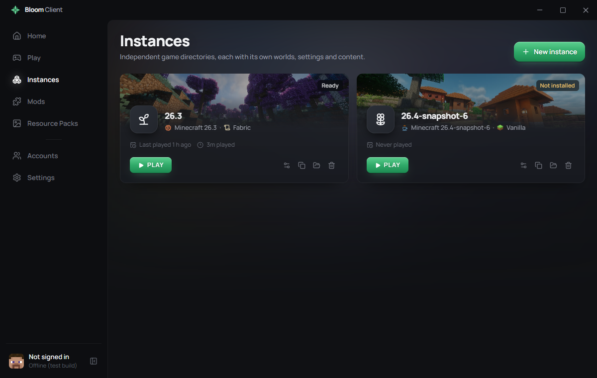
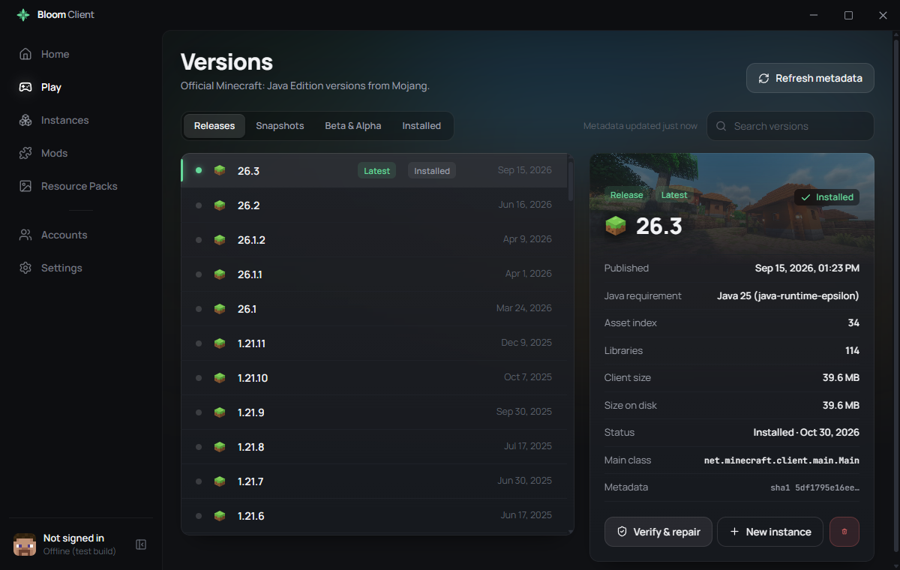
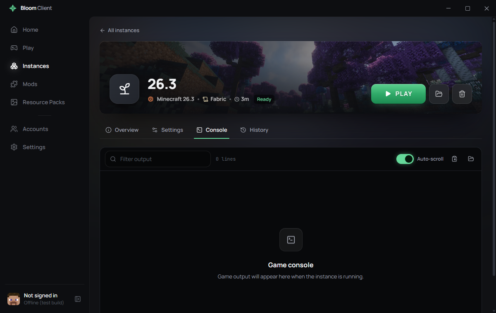

# Bloom Client

**A modern, lightweight and performance-focused Minecraft launcher.**

Bloom is a desktop Minecraft: Java Edition launcher built with Tauri 2 (Rust)
and React. This is Milestone 01: the desktop launcher. The in-game client,
HUDs, proprietary mods and FPS optimizations are later milestones. The
architecture already has extension points for them (see
[docs/ARCHITECTURE.md](docs/ARCHITECTURE.md)).

> Not an official Minecraft product. Not approved by or associated with Mojang or Microsoft.



| Instances | Versions | Game console |
|---|---|---|
|  |  |  |

## Microsoft sign-in & privacy

Bloom signs players in with the official Microsoft → Xbox Live → XSTS →
Minecraft Services chain, the same one used by the official launcher:

- **No passwords in the launcher.** Sign-in happens on Microsoft's own website
  in the system browser, using OAuth 2.0 Authorization Code with PKCE (public
  client, no client secret). Bloom only receives the authorization code on a
  one-off `127.0.0.1` redirect.
- **Minimal scopes:** `XboxLive.signin` and `offline_access`.
- **APIs used:** `login.microsoftonline.com` (consumers tenant),
  `user.auth.xboxlive.com`, `xsts.auth.xboxlive.com`,
  `api.minecraftservices.com` (login, entitlements/ownership check, profile)
  and `textures.minecraft.net` (the player's own skin, for the avatar).
- **Token storage:** refresh and access tokens live in the Windows Credential
  Manager, never in plain-text files or in the database. Tokens are redacted
  from game logs.
- **No third parties.** Bloom has no backend of its own; tokens and profile
  data are never sent anywhere except the Microsoft/Mojang endpoints above.
- **Ownership is enforced:** accounts that don't own Minecraft: Java Edition
  can't launch the game.

Details and setup: [docs/MICROSOFT_AUTH.md](docs/MICROSOFT_AUTH.md).

## Features (Milestone 01)

| Area | Status |
|---|---|
| Custom title bar (drag, minimize/maximize/close, Windows 10/11 shadow), animated collapsible sidebar, page transitions | Done |
| Home dashboard: hero with PLAY, instance quick switch, live launch progress with real counters, last session, account status, Mojang patch notes, quick settings, version info | Done |
| Version manager: official Mojang manifest, releases/snapshots/beta/alpha, metadata details (Java requirement, assets, libraries, size), install, verify & repair, delete, metadata refresh, offline cache | Done, tested |
| Installation engine: client jar, OS/arch-specific libraries, asset index + assets, logging configs, legacy virtual/resources assets, natives; parallel downloads (configurable), retries with backoff, HTTP Range resume, SHA1 verification, persistent verified-file cache, idempotent, repairs corrupt or missing files | Done, tested (26.3, 1.8.9) |
| Java manager: system detection (PATH, JAVA_HOME, registry, vendor folders, official launcher runtimes), executable probing, per-version automatic runtime from Mojang's official runtime manifest, manual selection, per-instance runtime, JVM arguments | Done, tested (Java 25 and Java 8 downloaded automatically) |
| Microsoft authentication: OAuth Authorization Code + PKCE in the system browser, Xbox Live, XSTS, Minecraft Services, ownership check, profile and skin, logout, automatic session renewal, tokens in Windows Credential Manager | Implemented; Microsoft/Xbox steps working, **awaiting Mojang approval** of the Azure app for the Minecraft API ([docs/MICROSOFT_AUTH.md](docs/MICROSOFT_AUTH.md)) |
| Instances: name, icon, version, isolated directory, Java, RAM, resolution, fullscreen, JVM args, duplicate, delete, install state, play time | Done, tested |
| Loader adapters: Vanilla and Fabric (profile from Fabric Meta, offline reuse); Forge / NeoForge shown as "coming soon" | Vanilla, Fabric |
| Bloom Native World Engine: per-instance world renderer, Rust (native chunk mesher, Fabric) or Java (vanilla), separate groups with icons in the version picker | Milestone 02.1, see [bloom-performance-engine/](bloom-performance-engine/README.md) |
| Game launcher: metadata-driven classpath and JVM/game arguments (modern and legacy formats, rules, `versionRange`, `default-user-jvm`), separate process, stdout/stderr capture, log4j XML → readable lines, token redaction, exit and crash detection, duplicate-launch protection, stop, launch history and log viewer | Done, tested |
| Mods: list with metadata (Fabric, Quilt, Forge, NeoForge, legacy mcmod.info), enable/disable, delete, details, search, import `.jar` | Done, tested |
| Resource packs: list with `pack.png` preview and description, enable/disable through the instance's `options.txt`, delete, import ZIP (validated), search | Done, tested |
| Settings: general (language EN/IT, theme, reduced motion, autostart, close to tray, notifications), Minecraft, Java, launcher (directories, concurrency, cache management, auto-update, log level), advanced (system/GPU info, Java and Minecraft diagnostics, folders, diagnostics export, Azure client ID, reset), about/updates | Done, tested (saved and applied) |
| SQLite with versioned migrations and automatic backups | Done, tested |
| Auto-updater (official Tauri updater, minisign-signed packages) | Ready; **needs an update endpoint** ([docs/RELEASING.md](docs/RELEASING.md)) |
| Windows NSIS installer | Built |

## Quick start (development)

Requirements: Windows 10/11, [Rust](https://rustup.rs) (MSVC), Visual Studio
Build Tools (C++ workload), WebView2 Runtime, Node.js 20+.

```powershell
npm install
npm run app:dev
```

To enable Microsoft sign-in, see [docs/MICROSOFT_AUTH.md](docs/MICROSOFT_AUTH.md).

## Build

```powershell
.\scripts\build-windows.ps1          # all checks + NSIS installer
```

Output: `src-tauri\target\release\bundle\nsis\Bloom Client_0.1.0_x64-setup.exe`.
For signed releases and the update feed, see
[docs/RELEASING.md](docs/RELEASING.md).

## Checks

```powershell
npm run typecheck      # TypeScript
npm test               # Vitest
npm run check:rust     # cargo check + clippy -D warnings
npm run test:rust      # Rust unit tests (43)
```

## Project structure

```
src/                      React frontend
  app/ layouts/ pages/ components/ features/{home,play,instances,settings,...}
  hooks/ stores/ services/ types/ utils/ styles/ i18n/ assets/
src-tauri/src/            Rust backend
  commands/ services/ minecraft/ authentication/ downloads/ installation/
  java/ instances/ launcher/ database/ updater/ system/ models/ errors/
docs/                     architecture, auth setup, release process
scripts/                  repeatable Windows build
```

## External configuration still required

1. **Azure application client ID** for Microsoft sign-in, plus **Mojang
   approval** of that application for the Minecraft Services API.
   See [docs/MICROSOFT_AUTH.md](docs/MICROSOFT_AUTH.md).
2. **Update endpoint** (`BLOOM_UPDATE_ENDPOINT`) and a production signing key
   for the updater. See [docs/RELEASING.md](docs/RELEASING.md).
3. Optionally, an **Authenticode certificate** to sign the installer (avoids
   the SmartScreen warning), and `BLOOM_ANNOUNCEMENTS_URL` for Bloom's own news.

## Not implemented in this milestone

- Forge, NeoForge and Quilt loader installation (the adapter interfaces exist)
- Mod and resource pack downloads from external platforms
- In-game client, HUDs, Bloom Performance Engine, FPS boost, JAR optimizations, cosmetics, friends/social, performance profiles, in-game component updates
- Linux/macOS packaging. The code is platform-aware (credential backends, rule engine, Java platforms), but only Windows has been built and tested.
- Quick Play and demo-mode launch options
